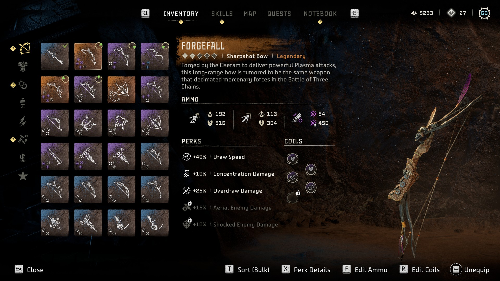
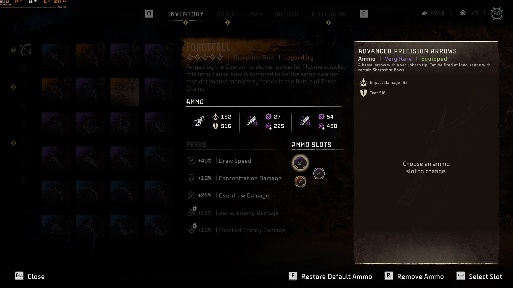
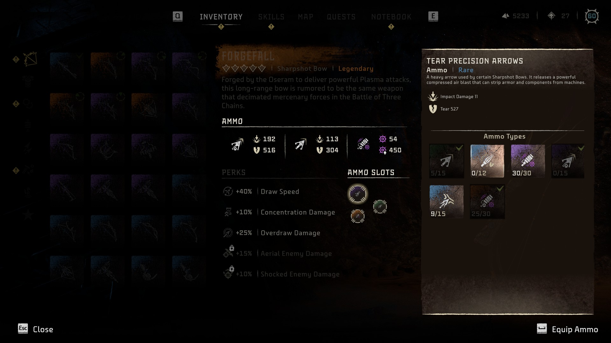

# HFW Ammo Swap

A [Native Loader](https://www.nexusmods.com/horizonforbiddenwest/mods/223) mod for **Horizon Forbidden West Complete Edition** (PC) that lets you choose which ammo types a weapon carries, the same way you choose its coils.







## Features

- **Edit Ammo** on every ranged weapon that can use more than one ammo type: bows, slings, tripcasters, spike throwers, boltblasters and so on. It opens the game's coil editing screen for the weapon's ammo slots.
- **Swap** any ammo type the weapon supports into a slot, as long as one of your weapons already has it or comes with it. The other weapon keeps its ammo (it is copied, not moved).
- **Remove** ammo from a slot to cycle through fewer ammo types.
- **Restore** the ammo the weapon comes with in one press.
- **Damage per ammo type**: ammo descriptions list the damage that ammo does on the weapon you are editing, with its upgrades and coils.
- The weapon's Ammo panel and the HUD show the new ammo. Changes are stored in your save like the game's own ammo.

## Requirements

- Horizon Forbidden West Complete Edition. Made on **v1.5.80.0** (Steam). At startup the mod looks for the game code it uses; on a version where it can't find all of it, it turns itself off and says so in its log.
- [Native Loader](https://www.nexusmods.com/horizonforbiddenwest/mods/223).

## Installation

1. Install Native Loader: its `winmm.dll` goes next to `HorizonForbiddenWest.exe`.
2. Download `HFWAmmoSwap-<version>.zip` from [Releases](../../releases).
3. Extract it into `<game folder>\nativemods\`, so the DLL ends up at `<game folder>\nativemods\HFWAmmoSwap\HFWAmmoSwap.dll`.

To update, replace that folder with the new one.

## Usage

Open the inventory, select a weapon and use **Edit Ammo**.

| Action | Controller | Keyboard |
| --- | --- | --- |
| Edit Ammo (weapon selected) | Triangle | F |
| Select the slot to change | Cross | Enter |
| Put the highlighted ammo into the slot | Cross | Enter |
| Remove Ammo from the selected slot | Square | R |
| Restore Default Ammo (slot row) | Triangle | F |
| Back | Circle | Esc |

- The slot row shows as many slots as the weapon has at its upgrade level. Filled slots come first; removing ammo moves the later ones up. A weapon keeps at least one ammo type.
- Ammo already on the weapon is greyed out: each ammo type fits in one slot per weapon.
- Ammo types you have none of are listed too, with a count of 0, so you can set them up before crafting.

### Which ammo types are available

There is no separate unlock list. When the list opens, the mod checks every weapon you own: an ammo type is available if any of them has it in a slot or comes with it at its current upgrade level, and the weapon you are editing can fire it. Ammo a weapon only gets from a later upgrade counts once that upgrade is done.

### Damage numbers

The numbers come from the same game code that fills a weapon's Ammo panel: the ammo's base damage, adjusted by that weapon's bonuses for each damage type (its upgrade level and coils). The same arrow can do different damage on different bows of a family.

## Uninstalling

Use **Restore Default Ammo** on every weapon you changed and save. A save with ammo a weapon doesn't come with relies on the mod to load that ammo. Then delete `nativemods\HFWAmmoSwap`.

## Troubleshooting

The mod writes `HFWAmmoSwap.log` next to its DLL: game build and address lookup, opening and closing Edit Ammo, every swap, and the location of any crash. Include it when you report a problem.

## Building

Requirements: Visual Studio 2022 or later (or the Build Tools) with the **Desktop development with C++** workload.

```
git clone --recursive https://github.com/xeropresence/HFWAmmoSwap.git
cd HFWAmmoSwap
build.cmd
```

`build.cmd` finds the compiler with `vswhere`, builds [MinHook](https://github.com/TsudaKageyu/minhook) (a submodule in `third_party/minhook`) and the mod, and writes `build\HFWAmmoSwap.dll` and the release zip `build\HFWAmmoSwap.zip`. Set `AMMOSWAP_VERSION` to stamp a version into the DLL's log line.

### Releases

GitHub Actions builds every push and pull request; the zip and PDB are attached to the run as an artifact. Pushing a tag that starts with `v` (for example `v1.0.0`) also publishes a GitHub release with `HFWAmmoSwap-<tag>.zip`.

```
git tag v1.0.0
git push origin v1.0.0
```

The same tag also adds the zip as a new version of the mod's file on Nexus Mods, once the repository is set up for it:

1. Upload the first zip to the Nexus Mods page by hand; the action can only add versions to an existing file.
2. Note the mod ID and that file's ID (Files tab, "Advanced").
3. In the GitHub repository settings (Secrets and variables → Actions), add the secret `NEXUSMODS_API_KEY` (a [Nexus Mods API key](https://www.nexusmods.com/settings/api-keys)) on the Secrets tab, and `NEXUS_MOD_ID` and `NEXUS_FILE_ID` on the Variables tab.

Each upload archives the previous version, sets the mod's version to the tag (without the `v`) and adds a changelog entry linking to the GitHub release. Until `NEXUS_FILE_ID` is set the `nexus` job is skipped.

Releases are immutable, so re-running a whole tag run fails at publishing the release. To retry a failed upload, use "Re-run failed jobs". To upload a release that was published before the repository was set up, push a tag named `nexus-` plus that release's tag; it uploads the release's zip and can be deleted afterwards:

```
git tag nexus-v1.0.1
git push origin nexus-v1.0.1
```

## How it works

The mod hooks the game's `InventoryMenuController` and menu code:

- **Prompt**: the outfit "Apply Visuals" input binding is reused as "Edit Ammo" on weapons; pressing it runs the "Edit Coils" binding's actions with ammo mode on.
- **Edit view**: in ammo mode the controller functions behind the coil editing screen (populate list, select socket, preview, equip, unequip) write the weapon's ammo slots and the available ammo into the menu data tree instead. Coil texts that read differently are replaced while ammo mode is on. A Triangle binding for Restore Default Ammo is added to the slot row panel whenever it is set up. The mouse works like on the coil screen, except that moving the pointer off the slot row doesn't close the view; ammo mode ends when the inventory's item grid gets focus back.
- **Slots**: swaps rewrite the weapon's `AmmoSlotsComponent` slots in place (or its saved runtime data when the weapon isn't spawned). Adding and removing slots move the slots' weak pointers the way the game's own slot unlocks do.
- **Loading**: weapons load every ammo type they support, not only their default ones, so swapped-in ammo is available after loading a save.
- **Item details**: the Ammo panel shows what each slot actually holds, and the same panel code works out the damage lines for ammo descriptions.
- **Game addresses**: nothing is hardcoded. At startup `src/signatures.cpp` finds every function and data address it needs in the loaded game: byte patterns of function starts or of the code calling them, MSVC vtables by class name, and Decima RTTI descriptors by type name. Each lookup must find exactly one match, otherwise the mod stays off. The patterns were made with `tools/make_signatures.py` (IDA Python); after a game update breaks one, find the function again and run `code_sig(ea)` or `ref_sig(target)` for a new pattern.

## Credits

- [Native Loader](https://www.nexusmods.com/horizonforbiddenwest/mods/223) by ewanhowell5195
- [MinHook](https://github.com/TsudaKageyu/minhook) by Tsuda Kageyu (BSD 2-Clause)

## License

[GPL-3.0](LICENSE)
